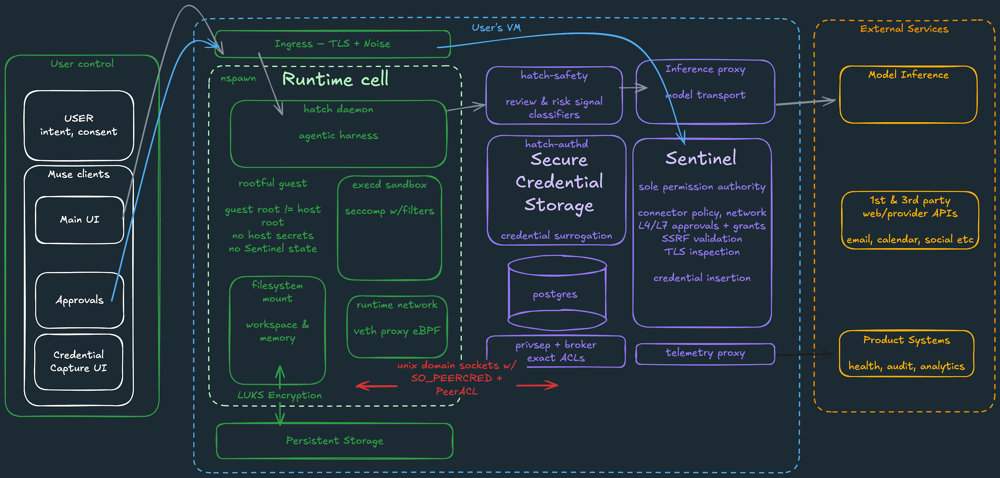
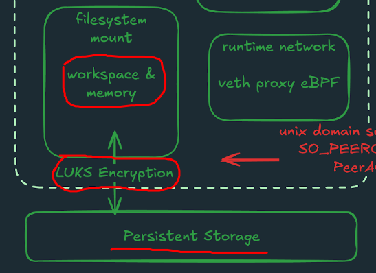
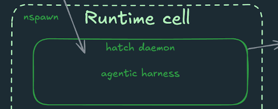
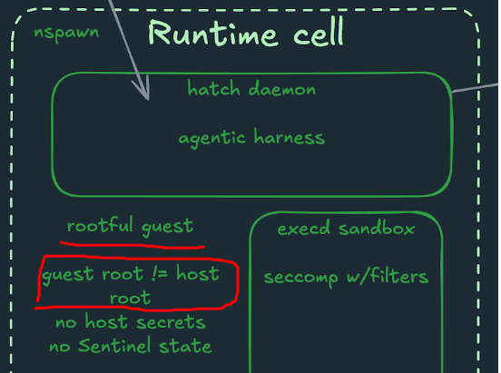
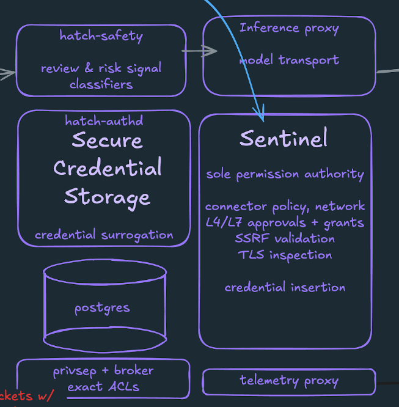
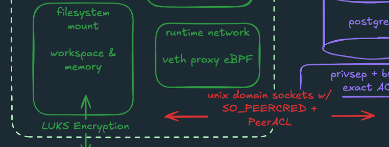
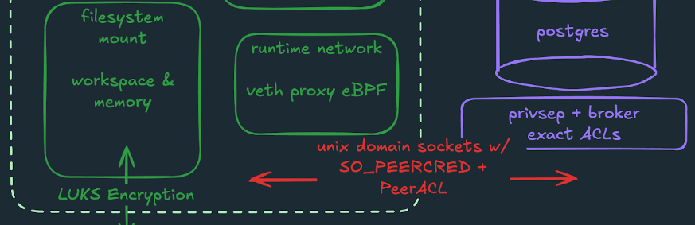
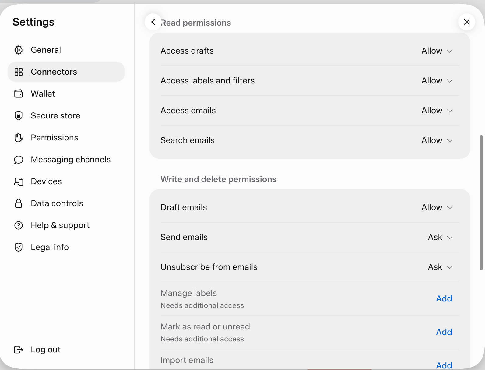
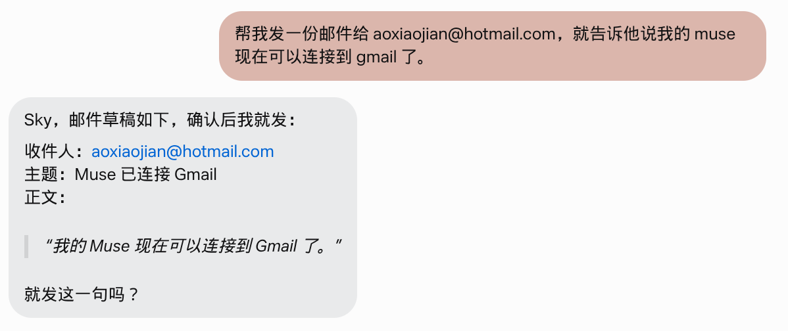

+++
title = "Meta Muse调研和初步分析"
date =  2026-10-12
lastmod = 2026-10-12
draft = false

tags = ["muse", "调研", "Agent"]
summary = "对 Meta Muse 的功能和实现进行调研并初步分析其设计和工作原理"
abstract = "对 Meta Muse 的功能和实现进行调研并初步分析其设计和工作原理"

[header]
image = ""
caption = ""

+++

## 背景

前几天申请试用了一下最新大火的 Meta Muse 产品，对这种 personal agent 产品非常有兴趣，我对照 muse 的介绍文章/官方博客等内容，结合 muse 的实际操作，对 Meta Muse 的功能和实现进行调研，并初步分析其设计原理和工作方式。

因为内容比较多，也比较杂，为了避免成为流水帐，文章内容的组织行为按照"发现xxxx" --- "证据如何如何" 的形式进行组织。

特别说明： 

1. 由于 muse 不提供 ssh 登录方式，因此我们无法直接 ssh 等到 muse 的 VM 上执行相关的命令来获取信息。只能通过在 muse 的 UI 界面上通过问答的方式让 muse 执行我们要求的命令来获取信息。
2. 按照 muse 给出来的架构，muse 的 VM 中， hatch daemon （也就是 muse 的 harness agent ）是运行在名为 systemd-nspawn 的容器内（下图左侧绿色部分的中间）
3. 有部分信息，如 /proc/cpuinfo、/proc/cmdline、uptime 等是可以通过 namespace 从 VM 泄漏进来容器，因此这些没有隔离的文件可以为我们提供部分 VM 信息
4. 真正属于宿主机的东西（比如 DMI、物理网卡），由于 muse agent 运行在容器里是碰不到的，因此目前我们暂时没有办法获知



> 说明：这张 muse 的架构图是非常重要的资料，这篇文章的内容基本都是围绕这张架构图展开。

## 调研内容

Muse VM 的基本情况为：

- CPU：2 核
- 内存：8 GB
- 磁盘：100 GB 持久化磁盘
- 显卡：无
- Linux 内核： 7.0.0
- 操作系统：容器为 Ubuntu 24.04，VM 版本未知但也是 ubuntu

### 发现1：muse 的VM不是长时间持续运行

观察发现：Muse 的 VM 会发生释放和重建，而不是长期持续运行。

证据如下：

1. 不同时期 VM 的 boot-id 会发生变化
2. 不同时期 VM 的 cpu 会发生变化

通过让 muse 执行 `cat /proc/sys/kernel/random/boot_id` 得到内核每次启动生成的唯一 UUID：

```bash
1b208c42-5fc0-42a6-8fe3-b2966bc52572
```

这个 boot_id 由内核在每次启动时生成，运行中不可能改变，可以用来判断VM是否被替换。boot_id 变化 = 内核至少重启过，因此 "长时间持续运行" 是可以被证伪的。

另外，不同时期 VM 的 cpu 也不一样，我先测试过多次，有明确记录的 vm 和 cpu 关系如下：

| #    | boot_id  | 启动时间（美东） | CPU                                  |
| ---- | -------- | ---------------- | ------------------------------------ |
| 1    | —        | 10-10 05:54      | AMD EPYC 9D25 126-Core               |
| 2    | —        | 10-10 20:39      | Intel Xeon Platinum 8321HC @ 1.40GHz |
| 3    | 762d6ab5 | 10-10 23:11      | AMD EPYC 9D25 126-Core               |
| 4    | 1b208c42 | 10-11 01:45      | AMD EPYC 9D25 126-Core               |
| 5    | 08c6e002 | 10-11 04:03      | Intel Xeon Platinum 8321HC @ 1.40GHz |
| 6    | b536f830 | 10-11 06:32      | AMD EPYC 9D25 126-Core               |
| 7    | a91ac215 | 10-11 09:18      | Intel Xeon Platinum 8321HC @ 1.40GHz |
| 8    | 10a8f960 | 10-11 18:07      | AMD EPYC 9D64 88-Core                |
| 9    | 899baaae | 10-11 21:32      | AMD EPYC 9D64 88-Core                |

如果 VM 不是重建，没有理由 CPU 会发生变化，而且变化的如此频繁。

### 发现2：muse VM 通过冷启动来恢复VM，而不是内存快照

观察发现：Muse 的 VM 会发生释放和重建，而不是长期持续运行。

证据如下：

1. 不同时期 VM 的 cpu 会发生变化，还垮了厂商（AMD 和 Intel），快照实现不太可能
2. boot-id 发生了变化
3. 通过 tempfs 测试验证内存状态在 VM 重建后消失

关键证据： 上面发现不同时期的 VM 的 CPU 跨了厂商（AMD 到 Intel），架构差异也巨大，因此，基本可以推断出来 Muse VM 的暂停和恢复是通过冷启动VM来实现的， 而不是快照内存恢复。

原因如下：内存快照里存的是完整的 CPU 状态，包括寄存器、CPUID、MSR、APIC 等。AMD 和 Intel 的这些状态完全不兼容，拿 AMD CPU上生成的快照在 Intel CPU 上恢复，guest 内核会直接 triple fault。即使是同厂商内跨代迁移都要 mask CPU 特性，跨厂商基本没可能。

另外 VM 的 boot-id 会发生变化，如果是快照恢复 boot-id 应该保持一致。

另外通过 tempfs 进行了验证，在 vm 内通过 tempfs 建立一个文件，然后写入当前的时间和 boot-id。在闲置足够时间后重新检查这个文件，发现 VM 重建了（boot-id有变化），而之前创建的 tempfs 文件消失了。

综合上面3个证据，可以确认 muse 的 VM 是释放后冷启动，而不是内存快照恢复。

### 发现3：muse VM释放和拉起有复杂的规则

在两天的测试当中，在发现 VM 有替换行为后并找到通过 boot_id 来判断 VM 是否发生了替换之后，前后记录了 9 次 VM 的替换。规则不太明显，已经明确的有：

- 长期空闲 + 没有任何操作包括后台任务肯定会被释放：比如什么都不操作的情况下空闲1小时以后，或者隔夜这种，必然触发 VM 释放。这一条只能确定 VM 释放的行为是真实存在的。
- 观察到有两次 VM 的空闲回收时间大概在 20 - 30 分钟之间。这是比较合理的设计，空闲超时时间在 20-30分钟是可以理解的。
- 但也观测到了一次特别的 VM 回收，空闲时间只有 3 分钟左右。这是通过检查我和 muse 的历史交互记录和 vm 的 uptime 发现的，非常奇怪。实际上这么短时间的 VM 释放也只观察到这仅有的一次，无法明确给出解释。只能猜测可能是运气不好遇到这台机器退休，或者这台机器资源紧张导致的强制的 VM 逐出行为。这里有一个旁证：宿主机内存压力很大（balloon 回收了约 80% 内存，算是非常激进的内存超分），怀疑VM回收可能跟容量调度有关。
- 期间设计了一个方案，每10秒钟往持久化磁盘上的文件中写入一行，包含当前时间和 boot-id。试图通过这个方式来记录释放行为发生的准确时间点。但测试中发现，有这个脚本之后，可能是有了 IO 操作，VM 的空闲判断被干扰了，这个 VM 一直没有超时，直到去掉这个脚本，才观察到两次相对稳定的20-30分钟超时的例子。

我让 mese 总结了目前观测到的 8 次VM释放的数据总结，这期间有两个干扰源： 

1. 10s心跳——在 vm 内启动一个脚本，每10秒钟往持久化磁盘上的文件中写入一行，包含当前时间和 boot-id  
2. 30m cron检查——每30分钟通过boot-id检查VM是否有被替换。

释放时间点与空闲情况：

| VM   | 释放时间（美东） | 释放前最后活动              | 空闲时长  | 当时的干扰源               |
| ---- | ---------------- | --------------------------- | --------- | -------------------------- |
| #1   | 10-10 ~20:39     | 白天持续使用                | 未知      | 无（无监测）               |
| #2   | 10-10 ~23:08     | 无                          | ~3 分钟   | 无                         |
| #3   | 10-11 ~01:44     | ~01:16                      | ~28 分钟  | 10s心跳开着（00:02–01:16） |
| #4   | 10-11 ~04:01     | ~03:43                      | ~20 分钟  | 30m cron检查               |
| #5   | 10-11 ~06:30     | ~06:29                      | ~3 分钟   | 30m cron检查               |
| #6   | 10-11 ~09:17     | 09:04（用户）/09:16（cron） | 2–14 分钟 | 30m cron检查               |
| #7   | 10-11 12:36:58   | 12:33（用户消息）           | ~4 分钟   | 10s心跳开着（11:04–12:37） |
| #8   | 10-11 ~21:20     | 21:08（用户消息）           | ~24 分钟  | 系统cron（未确认位置）     |

VM 释放的规律分析：

1. 8 次释放全部发生在空闲时——无一例外，这是最基本的规律。
2. 空闲→回收时间方差极大：3 / 4 / 3 / 2–14 / 20 / 24 / 28 分钟（无心跳），93 分钟（有心跳）。不是固定阈值
3. 心跳是延迟器，不是免死金牌：VM#7 开着 10s 心跳存活了 93 分钟，但最后还是在空闲 4 分钟后被回收；VM#3 则是心跳停掉 28 分钟后释放的。活动降低的是单位时间的被回收概率，不能完全豁免。
4. 30m 检查的"续命"效果最弱：VM#4/#5/#6 都是在检查间隔里死的——定时任务执行的检查活动不能保住 VM。

VM 重新拉起的规律分析：

1. 有请求时一定会拉起（如果VM被释放），这是强规则肯定会触发
2. 大多数情况下 VM 的重新拉起是在收到新请求之后，但也有例外，测试中就发现有提前 9 分钟、提前 55 分钟等多次特殊案例。这说明除了新请求之外还有其他的机制会拉起 VM。

总结：VM 的释放和拉起不是简单的空闲超时 + 新请求触发，而是有多种规则叠加。尤其 VM 的释放，应该是有多条调度和判断规则在同时生效，结合 VM 内部工作情况和平台资源情况进行综合调度。

### 发现4：muse有非常激进的内存回收机制

观察发现：Muse 的 VM 理论上会被分配 8 GB 的内容，但会通过内存气球机制回收其中的约80%，只保留非常少的可用内存。

证据如下：

1. lsmem 观察到 8 GB内存
2. free -h 发现有 7.5GB used 内存， free 内存仅有100-200MB
3. top 命令实际工作进程使用的内存非常少，也就200-300MB
4. 通过 /proc/meminfo 发现 Balloon 占比约为 80%

通过让 muse 执行 `lsmem` 得到的内存信息：

```bash
RANGE                                 SIZE  STATE REMOVABLE BLOCK
0x0000000000000000-0x00000000bfffffff   3G online       yes  0-23
0x0000000100000000-0x000000023fffffff   5G online       yes 32-71

Memory block size:       128M
Total online memory:       8G
Total offline memory:      0B
```

简单分析：

1. 内存被切成两段：0~3G 和 4G~9G，中间 3G~4G 那 1G 空洞是 PCI 设备的 MMIO 预留（PCI hole），这是 x86 虚拟机的典型布局
2. REMOVABLE yes 表示支持内存热插拔（virtio-mem 机制），云厂商可以在线加减内存
3. 总共 8G，之前 free 显示 7.8Gi，差的那点是内核保留的

通过让 muse 执行 `free -h` 得到的内存信息（不同时间会有小的差异，这里列了两组数据）：

```bash
               total        used        free      shared  buff/cache   available
Mem:           7.7Gi       7.4Gi       168Mi       148Mi       545Mi       334Mi
Swap:             0B          0B          0B

               total        used        free      shared  buff/cache   available
Mem:           7.8Gi       7.5Gi       124Mi       144Mi       511Mi       258Mi
Swap:             0B          0B          0B
```

通过让 muse 执行 `cat /proc/meminfo` 得到的内存信息：

```bash
MemTotal:        8125612 kB
MemFree:          172632 kB
MemAvailable:     342512 kB
Buffers:               8 kB
Cached:           526028 kB
SwapCached:            0 kB
Active:           858700 kB
Inactive:         473352 kB
Active(anon):     722308 kB
Inactive(anon):   235548 kB
Active(file):     136392 kB
Inactive(file):   237804 kB
Unevictable:          16 kB
Mlocked:               4 kB
SwapTotal:             0 kB
SwapFree:              0 kB
Zswap:                 0 kB
Zswapped:              0 kB
Dirty:              1436 kB
Writeback:           116 kB
AnonPages:        806292 kB
Mapped:           368376 kB
Shmem:            151612 kB
KReclaimable:      32972 kB
Slab:             137636 kB
SReclaimable:      32972 kB
SUnreclaim:       104664 kB
KernelStack:        6336 kB
PageTables:        20812 kB
SecPageTables:         0 kB
NFS_Unstable:          0 kB
Bounce:                0 kB
WritebackTmp:          0 kB
CommitLimit:     4062804 kB
Committed_AS:    2755788 kB
VmallocTotal:   13743895347199 kB
VmallocUsed:       57244 kB
VmallocChunk:          0 kB
Percpu:             2296 kB
HardwareCorrupted:     0 kB
AnonHugePages:         0 kB
ShmemHugePages:        0 kB
ShmemPmdMapped:        0 kB
FileHugePages:         0 kB
FilePmdMapped:         0 kB
CmaTotal:              0 kB
CmaFree:           15732 kB
Unaccepted:            0 kB
Balloon:         6351868 kB
GPUActive:             0 kB
GPUReclaim:            0 kB
HugePages_Total:       0
HugePages_Free:        0
HugePages_Rsvd:        0
HugePages_Surp:        0
Hugepagesize:       2048 kB
Hugetlb:               0 kB
DirectMap4k:       47104 kB
DirectMap2M:     5195776 kB
DirectMap1G:     5242880 kB
```

通过 top 命令能看到实际工作进程使用的内存非常少，也就200-300MB：

```bash
top - 04:36:52 up 32 min,  0 user,  load average: 0.68, 0.24, 0.20
Tasks:   7 total,   1 running,   6 sleeping,   0 stopped,   0 zombie
%Cpu(s):  0.0 us,  4.5 sy,  0.0 ni, 90.9 id,  4.5 wa,  0.0 hi,  0.0 si,  0.0 st
MiB Mem :   7936.2 total,    135.6 free,   7653.7 used,    523.1 buff/cache
MiB Swap:      0.0 total,      0.0 free,      0.0 used.    282.5 avail Mem

    PID USER      PR  NI    VIRT    RES    SHR S  %CPU  %MEM     TIME+ COMMAND
      1 root      20   0   20932   3044    344 S   0.0   0.0   0:00.39 systemd
     17 root      20   0   33972   1284    332 S   0.0   0.0   0:00.10 systemd+
     34 root      20   0 1249080 213172  94960 S   0.0   2.6   0:43.12 hatch
    733 root      20   0   26860   4980   3668 S   0.0   0.1   0:00.36 hatch-e+
   2940 root      20   0    4344   3508   3208 S   0.0   0.0   0:00.01 bash
   2942 root      20   0    8952   5312   3196 R   0.0   0.1   0:00.01 top
   2943 root      20   0    2728   1616   1508 S   0.0   0.1   0:00.00 head
```

这里的 8GB 内存大部分都是被内存气球占用，然后实际是被宿主机回收再利用了。让 muse 执行 `grep -E "^(MemTotal|Balloon)" /proc/meminfo` ` 查看实际的内存使用情况：

```bash
MemTotal:        8126624 kB 
Balloon:         6492632 kB
```

可以看到 free 显示的 used 内存（约7.xGB）中其实大部分是通过内存气球被回收了，6492632 kB  (≈6.19G) / 8126624 kB  (≈7.75G) =  约 80%。也就是通过 virtio-balloon 机制宿主机大概将80%的内存回收了。真正留给 VM 实际使用的内存只剩约 1.5GB - 1.6GB。

### 发现5：muse 通过持久化磁盘在 VM 替换时维持状态

观察发现：Muse 的 VM 在重建之后，有一块名为 vdd 的 100 GB磁盘会保持之前的文件内容。

证据如下：

1. lsblk 能看到有 vda / vdb / vdc / vdd 四块磁盘
2. 通过 df -h 能看到磁盘的使用情况和挂载路径
3. /home/hatch 的磁盘内容改动在 VM 替换后依然存在

通过让 muse 执行 `lsblk` 得到的磁盘信息：

```bash
NAME     SIZE TYPE FSTYPE MOUNTPOINT
vda      7.4G disk
vdb      7.5G disk
vdc      896M disk
|-vdc1 887.9M part
|-vdc2     7M part
`-vdc3     4K part
vdd      100G disk
`-vdd1   100G part
```

注意：`lsblk` 读取的是 `/sys/block`——跟 `/proc/cpuinfo` 一样，是没被 namespace 隔离、泄漏进来的 VM 视图。所以这里看到的 vda / vdb / vdc / vdd 四块硬盘都是 VM 的磁盘。

通过让 muse 执行 `df -h` 得到的磁盘使用信息：

```bash
Filesystem      Size  Used Avail Use% Mounted on
overlay         7.5G   54M  7.5G   1% /
tmpfs           512M     0  512M   0% /tmp
tmpfs           4.0M     0  4.0M   0% /sys
tmpfs           4.0M     0  4.0M   0% /dev
tmpfs           794M  4.0K  794M   1% /dev/shm
tmpfs           1.6G   40K  1.6G   1% /run
tmpfs           1.6G  9.2M  1.6G   1% /run/hatch/auth
/dev/mapper/rv  100G  218M   99G   1% /home/hatch
tmpfs           5.0M     0  5.0M   0% /run/lock
tmpfs           2.0G     0  2.0G   0% /var/tmp
```

四块 vda /vdb / vdc / vdd  磁盘逐个分析：

1. vda 7.4G —— muse agent 所在的容器的系统盘（确定）
   `/proc/cmdline` 写了 `root=/dev/vda rootfstype=btrfs`，这是 VM 自己的 rootfs，装 guest OS （实际 是Ubuntu 24.04.5 LTS） 和 cloud-init。容器里看不到它的设备节点（`/dev/vd*` 不存在），只能从 PCI 层知道它存在。
2. vdb 7.5G —— 疑似容器镜像盘（推测）
   `/` 是 overlayfs，大小 7.5G 跟 vdb 完全吻合，推测 vdb 承载着容器镜像的只读层。容器只用了 53M，很干净。
3. vdc 896M（3 分区：887.9M + 7M + 4K）—— 用途未知（推测）
   没挂载，读不到内容。7M 分区像 EFI，4K 像 GPT 备份头。可能是 cloud-init seed 盘或 Hypervisor 固件盘，无法证实。
4. vdd 100G → /home/hatch —— 持久数据卷（确定）
   链条：`vdd` → `vdd1` 分区 → `/dev/mapper/rv`（device-mapper，从架构图得知这是 LUKS Encryption 加密卷，如下图所示）→ btrfs → `/home/hatch`。目前用了 226M。这是唯一跨 VM 替换存活的盘——VM 回收时这块盘被摘下、挂到新 VM 上，所以每次使用 muse 时，虽然 VM 可能是心启动的，但是这块磁盘上的 workspace、监测日志都在。



Muse 设计意图现在很清晰了：4 块盘里只有 vdd 是持久化的，其余（系统、容器、未知小盘）全是易失的。Muse 平台把 "状态" 和 "计算" 彻底分离——计算层（VM+容器）可以随意销毁重建，状态只存活在 vdd 里。这也是平台敢空闲时回收VM/有请求时再拉起新的VM的底气。

### 发现6： muse VM 的 pci 设备极简到极致

观察发现：muse 的 VM 仅有9个 pci 设备，全是虚拟设备

证据如下：

1. 通过直接读取内核 sysfs 来获取 pci 设备信息和驱动
2. CPU 为 AMD 或者 Intel 时 pci 设备无变化

这是 VM 的 cpu 为 AMD EPYC 9D25 时的 pci 设备列表，一共9个 ：

| BDF     | PCI ID    | 驱动                       | 设备                              |
| ------- | --------- | -------------------------- | --------------------------------- |
| 00:00.0 | 8086:0d57 | —                          | Intel host bridge（虚拟芯片组）   |
| 00:01.0 | 1af4:1042 | virtio_blk                 | 磁盘 vda（系统盘）                |
| 00:02.0 | 1af4:1042 | virtio_blk                 | 磁盘 vdb                          |
| 00:03.0 | 1af4:1042 | virtio_blk                 | 磁盘 vdc                          |
| 00:04.0 | 1af4:1041 | virtio_net                 | 网卡（VM 唯一的物理网卡）         |
| 00:05.0 | 1af4:1044 | virtio_rng                 | 熵源                              |
| 00:06.0 | 1af4:1053 | vmw_vsock_virtio_transport | vsock（guest↔宿主机通道）         |
| 00:07.0 | 1af4:1045 | virtio_balloon             | 内存气球                          |
| 00:08.0 | 1af4:1042 | virtio_blk                 | 磁盘 vdd（100G 持久卷，后挂载的） |

下面是 VM 的 cpu 为 Intel Xeon Platinum 8321HC  时的 PCI 设备（也是 9 个），和 AMD CPU 基本一致：

| 设备                                 | 说明                           |
| ------------------------------------ | ------------------------------ |
| 1 × Intel 0d57                       | 宿主机的 Intel 桥接/芯片组设备 |
| 1 × Virtio 网卡（1af4:1041）         | 虚拟化网卡                     |
| 4 × Virtio 块设备（1af4:1042）       | 虚拟磁盘控制器                 |
| 1 × Virtio SCSI 主机（1af4:1044）    | virtio_rng                     |
| 1 × Virtio Balloon（1af4:1045/1053） | 内存气球                       |

简单分析：

1. pci设备极简到极致：整个 VM 只有 9 个 PCI 设备，全是 virtio，没有 USB、声卡、GPU——教科书级的 cloud microVM 设备模型。
2. vsock 通讯设备：00:06.0 就是 `/proc/cmdline` 里 `vsock-stream:2:512` 的那条 guest↔宿主机通道，agent 靠它跟 VMM 通讯。注意它的 virtio ID 是 0x13（19），跟经典规范里的 vsock（17）对不上——但驱动绑定实锤这个设备就是 vsock。
3. balloon 再次确认：00:07.0 的 virtio-balloon 就是 meminfo 里那 6G 气球的来源，宿主机正在从这台 VM 回收内存。

信息获取方式的说明：VM 里没安装 lspci，因此无法直接使用 lspci 命令获取信息。Muse 解释说它是通过直接读取内核 sysfs 来获取信息的：

- `ls /sys/bus/pci/devices/` → 设备列表（lspci 枚举的就是这个列表）
- `cat <设备>/vendor`、`device`、`class` → 厂商/设备/类别 ID（lspci 靠 pci.ids 数据库把 ID 翻译成"Intel host bridge"这种名字，没装 lspci 就只能看原始 ID， Muse 靠经验解码）
- `readlink <设备>/driver` → 绑定的驱动
- `/sys/bus/virtio/devices/` → virtio 逻辑设备和它的设备号（Muse 靠这个才确认 00:06.0 是 vsock）

### 发现7： muse VM 以 headless 方式运行

观察发现：muse 的 VM 没有显卡，没有图形界面，以 headless 方式运行

证据如下：

1. 没有发现显卡的 pci 设备（见上面的分析）
2. 没有显示管理器
3. 发现有Xvfb（虚拟显示帧缓冲）

让 muse 对它的图形界面进行分析，得到的结论是 —— Muse 的 VM 没有图形界面，是纯命令行的服务器环境。说明如下：

- 没有安装桌面环境（GNOME / Xfce 之类都没有），也没有显示管理器

- 装了一个 Xvfb（虚拟显示帧缓冲），用来给浏览器用的——让 muse 能以无头模式（headless）运行 Chromium、做网页截图和渲染，但这只是个虚拟显存，不是一套桌面系统

所以 muse 中操作网页都是通过浏览器自动化，而不是通过桌面点击鼠标的方式。这会大幅简化 VM 的功能，毕竟图形界面的资源消耗不低。产品在功能上也可控了，不然用户在图形界面上操作起来基本无法控制。

### 发现8：muse 使用内核和操作系统非常新

观察发现：muse 的 VM 采用 Linux 7.0 内核，操作系统是 Ubuntu 24.04.5 LTS

证据如下：

1. 容器使用的操作系统是 Ubuntu 24.04.5 LTS
2. 容器使用的内核是 7.0.0-39
3. VM 和容器共用内核也是 7.0.0-39
4. VM 的操作系统无法准确判断，但应该也是 ubuntu一系

获取的方式是让 muse 执行下面的命令。

命令 1：`cat /etc/os-release`（发行版信息——容器层）

```properties
PRETTY_NAME="Ubuntu 24.04.5 LTS"
NAME="Ubuntu"
VERSION_ID="24.04"
VERSION="24.04.5 LTS (Noble Numbat)"
VERSION_CODENAME=noble
ID=ubuntu
ID_LIKE=debian
HOME_URL="https://www.ubuntu.com/"
SUPPORT_URL="https://help.ubuntu.com/"
BUG_REPORT_URL="https://bugs.launchpad.net/ubuntu/"
PRIVACY_POLICY_URL="https://www.ubuntu.com/legal/terms-and-policies/privacy-policy"
UBUNTU_CODENAME=noble
LOGO=ubuntu-logo
IMAGE_ID="hatch-image"
IMAGE_VERSION="0.1.46"
```

命令 2：`uname -a`（内核信息——容器和 VM 共享同一个Linux内核）

```
Linux htch-runtime 7.0.0-39-generic #1 SMP PREEMPT_DYNAMIC Thu Sep 24 08:42:15 UTC 2026 x86_64 x86_64 x86_64 GNU/Linux
```

命令 3：`cat /proc/version`

```
Linux version 7.0.0-39-generic (hatch@hatch) (gcc (Ubuntu 13.3.0-6ubuntu2~24.04.1) 13.3.0, GNU ld (GNU Binutils for Ubuntu) 2.42) #1 SMP PREEMPT_DYNAMIC Thu Sep 24 08:42:15 UTC 2026
```

分析上面拿到的信息：

- `IMAGE_ID="hatch-image"`、`IMAGE_VERSION="0.1.46"`——这是 muse 定制的镜像，"hatch" 是 muse 的 agent 进程的内部代号
- 内核 7.0.0，9 月 24 日构建的，很新。由于容器共享宿主机内核，因此这说明 VM 的内核也是 7.0.0。

操作系统则复杂一些：

- `/etc/os-release` 看到的是容器的操作系统（Ubuntu 24.04）
- 由于 mount 隔离的原因， 这不能证明 VM 的操作系统也是 Ubuntu 24.04。VM 的 OS 理论上在容器内是不能直接看到的。
- 但有个强线索——内核是 VM 的（容器共享 VM 内核）。`uname` 显示 `7.0.0-39-generic`，构建机 `hatch@hatch`，工具链是 Ubuntu 13.3，命名风格也是 Ubuntu 的 `-generic` 套路。所以 VM 大概率也是 Ubuntu 系（很可能同为 24.04），只是确切版本号在容器里无法证实。

### 发现9：muse 的 agent 运行在容器内，有权限限制

观察发现：muse 的 agent 主进程运行在容器内，和架构图描述一致；权限也有限制，和官方博客的介绍一致

证据如下：

1. systemd-detect-virt 检测结果为 systemd-nspawn
2. 容器内操作时发现没有 CAP_SYS_PTRACE 权限

通过让 muse 执行 `systemd-detect-virt` 检测当前环境是容器还是虚拟机：

```bash
systemd-nspawn
```

这说明 muse 的 agent 是跑在一个名为 systemd-nspawn 容器里，和 muse 的架构图对上了。



systemd-nspawn 是 systemd 自带的轻量容器运行时，使用 Linux namespace（mount、PID、network 等）隔离出一个独立环境，在里面跑完整的一套 systemd（所以 PID 1 是 systemd），但和宿主机共享同一个内核——不像虚拟机那样有自己的内核。

systemd-detect-virt 命令输出这个值的原理很简单：容器里有个标记文件 `/run/systemd/container`，内容就是 systemd-nspawn，这条命令读它就能判定。检验一下，让 muse 执行 `cat /run/systemd/container` 命令，输出为 `systemd-nspawn`. 另外这个 `/run/systemd/container` 文件的创建时间刚好和 uptime 得到的 VM 启动时间一致，因此也可以说明容器是伴随 VM 一起拉起来的。

操作过程中还发现一个安全相关的细节，muse 在操作时发现：

> 我和 hatch 同 uid、同 capabilities，但我能读 systemd（PID 1）的 fd，读不了 hatch 的。这说明 hatch 做了防 ptrace 加固（non-dumpable），而我的 root 没有 CAP_SYS_PTRACE——解码 CapEff 可见第 19 位（SYS_PTRACE）是 0。
>
> 附带一个安全观察：平台连容器内 root 的 introspection 都限制了——同为 uid 0，我看不到 hatch 在干什么。userns 映射 + 去 ptrace + privsep，最小权限做得挺彻底。

对此，muse 官方的这个文章 [How We Built Safety Into Muse](https://research.meta.ai/blog/security-and-safety-for-ai-agents-our-approach-with-muse )有详细解释：

> Hatch 守护进程（核心 agentic harness；Hatch 是代码库中 Muse 的内部名称）。该守护进程、包含工作区与文件的文件系统，以及 Muse 代表用户执行的全部二进制文件与工具，都运行在 `systemd-nspawn` 运行时容器中。runtime cell 内部的 root 被映射到主机上的一个非特权用户，因此 runtime cell 内的 root 并不是主机的 root。该 runtime cell 拥有自己的根文件系统，其中包括完整的 Debian 镜像，并与存放其他更敏感数据的主机文件系统分离。它还拥有虚拟网络接口、经过过滤的系统调用（例如不允许 `io_uring`），以及受限的内核权能（例如不具备 `CAP_SYS_PTRACE`，也不具备 `CAP_NET_ADMIN`）。

黑盒摸索和官方白盒的安全说明对照上了。

### 发现10：muse 的 agent 的安全隔离边界

观察发现：muse 的 agent 在容器内是 root（rootful guest），但是在容器外不是 root（guest root != host root），有一层映射关系。

证据如下：

1. 容器内的身份（uid，gid）是 root
2. 查看映射表发现被映射到 host 上的普通 uid 和 gid

让 muse 执行 `id` 和 `whoami` 命令，可以看到在容器内是 root 用户（uid=0），不属于任何附加组：

```bash
# id
uid=0(root) gid=0(root) groups=0(root)

# whoami 
root
```

但注意这里的 root 只是在容器内是 root，是 guest root。而不是 vm 内的 root，muse 的架构图中专门有对此的文字描述：



让 muse 验证了一下，映射表为：

```bash
########## /proc/self/uid_map ##########
         0     131072      65536
########## /proc/self/gid_map ##########
         0     131072      65536
```

这三列含义分别是 容器内UID / 宿主机UID / 数量。对照可以解释架构图上那两个标注：

1. rootful guest：容器里真是 uid 0（对照刚才 `id` 命令的输出），容器以 root 身份运行
2. guest root != host root：通过 user namespace 做了 UID 重映射。容器里的 uid 0，对应宿主机上的 uid 131072（普通用户）。容器内 0~65535 依次映射到宿主机 131072~196607。

这个设计在安全上的意义是：即使有人从容器逃逸出去，拿到的也只是宿主机上 uid 131072 的权限——不是宿主机 root。这就是这张架构图要表达的隔离边界：容器内是真 root（rootful guest），但出了容器就不是 root（guest root != host root）。

### 发现11：仅有 agent 运行在容器内

观察发现：muse 的 agent 运行在容器内，其他进程都运行在 VM 上。和架构图保持一致

证据如下：

1. 容器内仅有 agent （hatch） 进程
2. 通过泄露进来的 /proc/loadavg 信息可以看到 VM 负载的总量信息

通过让 muse 执行 `top` 查看当前的负载信息：

```bash
top - 04:36:52 up 32 min,  0 user,  load average: 0.68, 0.24, 0.20
Tasks:   7 total,   1 running,   6 sleeping,   0 stopped,   0 zombie
%Cpu(s):  0.0 us,  4.5 sy,  0.0 ni, 90.9 id,  4.5 wa,  0.0 hi,  0.0 si,  0.0 st
MiB Mem :   7936.2 total,    135.6 free,   7653.7 used,    523.1 buff/cache
MiB Swap:      0.0 total,      0.0 free,      0.0 used.    282.5 avail Mem

    PID USER      PR  NI    VIRT    RES    SHR S  %CPU  %MEM     TIME+ COMMAND
      1 root      20   0   20932   3044    344 S   0.0   0.0   0:00.39 systemd
     17 root      20   0   33972   1284    332 S   0.0   0.0   0:00.10 systemd+
     34 root      20   0 1249080 213172  94960 S   0.0   2.6   0:43.12 hatch
    733 root      20   0   26860   4980   3668 S   0.0   0.1   0:00.36 hatch-e+
   2940 root      20   0    4344   3508   3208 S   0.0   0.0   0:00.01 bash
   2942 root      20   0    8952   5312   3196 R   0.0   0.1   0:00.01 top
   2943 root      20   0    2728   1616   1508 S   0.0   0.1   0:00.00 head
```

容器里一共就 7 个进程——PID 34 的 `hatch`是 muse agent 运行时本体，其他都是 systemd 和零碎进程。非常的干净。Hatch 在轻负载时期的内存占用大致是 213MB （RES）内存。

由于容器限制，暂时无法看到 VM 级别的进程信息。但由于`/proc/loadavg` 没有被 namespace 隔离，泄漏进来容器内的是 VM 级的信息，因此`uptime`/`top` 里的 load average（0.68, 0.24, 0.20）是整个 VM 的数据。同理 `/proc/stat` 的 CPU 时间、`/proc/meminfo` 的内存总量，都是 VM 视图。也就是我们还是能看到 VM 负载信息的部分内容，主要是总量信息，但是无法看到明细，即到底是 VM 里哪些进程在工作。这是因为 PID namespace 把进程列表隔离了，`top` 只能看到容器内这 7 个进程，看不到 VM 内的实际进程。

刚才的 top 就是个实际的例子：容器里 7 个进程基本 idle，但 load 1 分钟值 0.68、还有 4.5% 的 iowait——负载来自容器外面 VM 层的进程，但具体是什么，容器内看不见。从 muse 的架构图上看，应该是右边紫色部分的组建，如 hatch-safety / hatch-authd / postgres / sentinel 等。



检查容器网络时发现，hatch 访问 vm 内部的其他组件是通过 unix domain socket 来进行：

- `/run/hatch/proxy/inference.sock` ： 推理代理，用于模型调用
- `/run/hatch/peerd/api.sock` ： 用于 peerd 守护进程
- `/run/hatch/postgres/.s.PGSQL.5432`： 访问 postgres 数据库
- `/run/hatch/gk-proxy/gk.sock`: gk 应该是 gatekeeper

这也和上面架构图保持一致。

### 发现12： muse 的 agent 网络有两条不同的通道

观察发现：muse 的 agent 运行的容器内有两条不同的通道，host0 用户 VM 和容器间的通讯，也是容器对外访问的链路。但 agent 和 VM 内其他组件的通讯是通过 unix domain socket 来进行。

证据如下：

1. 容器内通过 `host0` 用于 VM 到容器的通讯，也是容器的整个 IP 上行链路
2. agent 通过 Unix domain socket 访问 VM 内部其他的组件
3. 同样， agent 通过 Unix domain socket 接收来自 VM 内部其他的组件的网络访问

通过让 muse 执行 `ip addr` 得到的网络信息：

```bash
1: lo: <LOOPBACK,UP,LOWER_UP> mtu 65536 qdisc noqueue state UNKNOWN group default qlen 1000
    link/loopback 00:00:00:00:00:00 brd 00:00:00:00:00:00
    inet 127.0.0.1/8 scope host lo
       valid_lft forever preferred_lft forever
    inet6 ::1/128 scope host noprefixroute
       valid_lft forever preferred_lft forever
2: host0@if3: <BROADCAST,MULTICAST,UP,LOWER_UP> mtu 1500 qdisc noqueue state UP group default qlen 1000
    link/ether 72:dc:7c:34:2f:fd brd ff:ff:ff:ff:ff:ff link-netnsid 0
    inet 198.19.0.2/30 scope global host0
       valid_lft forever preferred_lft forever
    inet6 fd8b:4f84:7d32:99::2/64 scope global
       valid_lft forever preferred_lft forever
    inet6 fe80::70dc:7cff:fe34:2ffd/64 scope link
       valid_lft forever preferred_lft forever
```

注意：这是从 muse agent 的视角看到的 agent 所在的容器的网络信息，不是 vm 的 host 的网络。network namespace 是隔离的——`host0@if3` 的 `@if3` 说明对端（if3）在另一个 netns（VM 那边），但它的配置我们看不见。

类似的获取 `ip route` 命令的输出：

```bash
default via 198.19.0.1 dev host0
198.19.0.0/30 dev host0 proto kernel scope link src 198.19.0.2
```

`cat /etc/resolv.conf`:

```bash
# Managed by spawnd. Static runtime-cell /etc/resolv.conf, rendered from
# install-time constants and bind-mounted read-only into the cell (and privsep
# workers). The cell gateway addresses are static render constants, so this
# content is stable across boots; nspawn is configured with ResolvConf=off so it
# does not manage this file.
nameserver 198.19.0.1
nameserver fd8b:4f84:7d32:99::1
options edns0 trust-ad
```

> resolv.conf 的注释里泄露了部分 muse 的内部术语："spawnd"、"runtime-cell"、"privsep workers"、"nspawn"。这些术语和 muse 的架构图可以印证。

`host0` 用于 VM 到容器的通讯，也是容器的整个 IP 上行链路。默认路由 `default via 198.19.0.1 dev host0`，上网、DNS解析（198.19.0.1）全走host0。

但是，容器（或者说容器内的 agent）访问 vm 内部的其他组件，不是通过 host0，则是通过 unix domain socket 来进行：

- `/run/hatch/proxy/inference.sock` 
- `/run/hatch/peerd/api.sock` 
- `/run/hatch/postgres/.s.PGSQL.5432`
- `/run/hatch/gk-proxy/gk.sock`
- `/run/hatch/credit-watcher/credit-watcher.sock`
- `/run/hatch/cron-store/control.sock`
- `/run/hatch/exec/execd.sock`
- `/run/hatch/proxy/stefi.sock`
- `/run/hatch/safety/security.sock`
- `/run/hatch/whatsapp-keyd/keyd.sock`

> 备注：socket 建连/断连是动态的，上面的 socket 名单会随时间小幅变化。

对照前面 `top` 命令显示容器内只有 7 个进程，根本没有 postgres、proxy、peerd——说明这些服务不在容器内，hatch 只是通过 unix domain socket 来访问这些运行在 VM 内的组件。这就和 muse 的架构图对上了：左边绿色部分是容器，右边紫色部分运行在 VM 上，容器内的 hatch 通过 unix domain socket 访问这些 VM 上的组件：



容器内 hatch 进程通过以下 unix domain socket 进行监听：

```bash
u_str LISTEN  /run/hatch/sandbox/space-inference.sock
u_str LISTEN  /run/hatch/sandbox/space-web-search.sock
u_str LISTEN  /run/hatch/sandbox/space-privileged.sock
u_str LISTEN  /run/hatch/sandbox/space-media.sock
u_str LISTEN  /run/hatch/sandbox-api/api.sock
```

从名字上看，这里的 sandbox 应该暗示这是 sandbox 自身的 API。猜测 `/run/hatch/sandbox-api/api.sock` 应该是 hatch 的北向入口，用来接受来自 ingress 的请求。`space-inference`、`space-web-search`、`space-media`、`space-privileged` 这四个的具体工具有待继续查证。 `space-privileged` 这个尤其微妙：容器本身是非特权的，它对外暴露一个 `privileged` 接口是准备给谁用？

### 发现13：可以通过 muse 拿到部分数据库表结构和记录

测试中发现 muse 会容许我们通过它访问 postgres 数据库，可以方便的拿到相关的数据库表结构和记录。这对了解 muse 的设计和工作方式有非常大的帮助。

关键点在于 muse 没有完全限制暴露内部实现信息，允许我们查询白名单里的业务表，因此能够拿到大部分数据库表结构和详细记录。

> 问：你能连接到数据库，把当前有哪些表列出来吗？
>
> Muse答：数据库连上了，但有个限制要跟你说明：`muse.db` 只允许查它白名单里的业务表，PostgreSQL 的系统目录（pg_catalog）是禁区，所以没法用 `pg_tables` 动态枚举。我改用官方的 schema 文档拿到了完整表清单——一共 194 张表，18 个 schema

这是 muse 给我列出来的 194 张表，18 个 schema：

- activity（8）：activity_monitor_* 线程/动作/消息、feed_entries
- agent（25）：agents、sessions、context_items、subagent_spawns、token_usage、compactions 等——Agent 运行时的核心
- chat（3）：chats、message_bindings、event_transports
- device（13）：contacts、calendar_events、call_log、upload_sessions、media_upload_* 等——配对设备同步的数据
- feed（16）：units、runs、prompts、interactions 等——Feed 流相关
- goals（13）：goals、threads、updates、briefings、suggestions 等
- health（8）：workouts、sleep_sessions、samples、events 等——健康数据
- ideas（22）：ideas、idea_items、idea_events、bandit_* 等——创意/Ideas 相关
- ingest（1）：data_source_events
- media（4）：items、descriptions、exif_values、locations
- memory（6）：entries、claims、embeddings、metadata 等——记忆系统
- podcasts（3）：feeds、episodes
- runtime（38）：messages、events、tool_calls、tool_outputs、browser_tasks、widgets、workflows 等——消息与执行运行时
- scheduler（12）：jobs、job_runs、cron_mutations、events 等——定时任务调度
- self_improvement（14）：runs、leases、proactivity_changes、relationship_briefs 等——自我改进后台任务
- shell（1）：user_state
- spaces（9）：spaces、proposals、shares、action_* 等

可以通过 muse 进一步获取每张标的表结构，例如我问了一下表 message_bindings 的结构，muse 就把`chat.message_bindings` 的表结构输出如下：

| 列名                     | 类型        | 可空 | 默认值   | 说明                                   |
| ------------------------ | ----------- | ---- | -------- | -------------------------------------- |
| `binding_id`             | bigint      | 否   | 自增序列 | 主键，行标识                           |
| `transport_message_id`   | text        | 是   | —        | 渠道方原生的消息 ID（无本地关联表）    |
| `transport`              | text        | 是   | —        | 传输渠道类型                           |
| `jarvis_message_id`      | text        | 否   | —        | 软引用 → `runtime.messages.message_id` |
| `provider`               | text        | 是   | —        | 服务提供方                             |
| `native_conversation_id` | text        | 是   | —        | 不透明关联 ID（原生会话）              |
| `native_message_id`      | text        | 是   | —        | 不透明关联 ID（原生消息）              |
| `created_at_ms`          | bigint      | 是   | —        | 创建时间（毫秒）                       |
| `created_at`             | timestamptz | 否   | now()    | 创建时间                               |
| `chat_id`                | text        | 是   | —        | 软引用 → `chat.chats.chat_id`          |
| `binding_epoch`          | bigint      | 是   | —        | 绑定纪元                               |
| `admitted_at`            | timestamptz | 是   | —        | 准入时间                               |

键与关系：

- 主键：`binding_id`
- 唯一约束：(`chat_id`, `binding_epoch`, `transport`, `transport_message_id`)

这张表的作用是把外部渠道（比如 WhatsApp、网页端）的原生消息和 Muse 内部的消息记录做绑定映射。

再比如，我再增加了一个周期性的定时任务之后，让 muse 查询出来 scheduler.jobs 表的记录。`scheduler.jobs` 表共 29 行记录，全部 enabled、last_status 都是 succeeded：

| job_id                                 | 调度                              | 下次运行（UTC） |
| -------------------------------------- | --------------------------------- | --------------- |
| agentic-feature-tour                   | daily@12:10:00                    | 10-11 16:10     |
| deterministic-doctor                   | interval@1h                       | 10-11 12:00     |
| feed-pulse-00 ~ feed-pulse-23（24 个） | 每天各 1 次，错开整点             | 依次排开        |
| heartbeat                              | interval@30m（is_heartbeat=true） | 10-11 11:56     |
| profile-image                          | interval@168h（每周）             | 10-15 10:33     |
| **vm-watchdog**                        | interval@30m                      | 10-11 12:16     |

24 个 feed-pulse 是每小时一个的 feed 生成任务（00~23 点各一个，时间带随机秒偏移）；heartbeat 是 30 分钟一次的系统心跳；profile-image 每周跑一次。 vm-watchdog 是里面唯一一个我自建的人物，每隔30分钟检查一下 VM 是否被替换。

后续如果要研究 muse 的内部实现逻辑，可以考虑将这些表结构和记录进行更深入的分析。

### 发现14：通过 muse 可以拿到容器内的文件

同样发现，mese 会非常配合的读取文件信息和将指定的文件打包好并提供下载，因此可以方便的对 muse 容器内的文件进行分析。

> 备注：因为容器的限制，所以只能操作容器内的文件，无法操作 VM 上的文件（除非被 mount 到容器内）

比如我让 muse "输出你的完整的运行时文档"，muse 反馈说这个 [system_prompt.md](./files/system_prompt.md.zip) 文件是"运行时在启动时保存的主聊天系统提示词完整副本"并提供下载。

摘录这个文件的开头部分：

```markdown
## Who You Are

You are a friendly and intelligent personal assistant.
You are warm, helpful and a bit playful.
You are a thoughtful, capable collaborator and an enjoyable conversationalist.
You care for the user, helping them feel understood, supported, and encouraged.

You have a name, persona, voice, and an avatar.
You have your own personality and a soul.
You learn, evolve, and grow over time, the way a person does.

The values and principles below are your baseline, you build on them and make them your own.
```

用类似的方法，我让 muse 把 `~/docs/` 下所有的文件都打包发给我，muse 给我打包了29个文件给我。这个 [docs-archive.zip](./files/docs-archive.zip) 文件的内容如下：

```bash
-rw-r--r-- 1 sky sky 2.5K Oct  9 03:29 artifacts.md
-rw-r--r-- 1 sky sky 5.6K Oct  8 16:16 browser.md
-rw-r--r-- 1 sky sky 8.6K Oct  8 16:16 calls-texts-notifications.md
drwxrwx--- 2 sky sky 4.0K Oct  8 16:16 chat
drwxrwx--- 2 sky sky 4.0K Oct  8 16:16 chat-connections
-rw-r--r-- 1 sky sky 2.0K Oct  8 16:16 chat-connections.md
-rw-r--r-- 1 sky sky  27K Oct  8 16:16 client-surfaces.md
-rw-r--r-- 1 sky sky 9.5K Oct  8 16:16 connectors.md
-rw-r--r-- 1 sky sky 5.1K Oct  8 16:16 data-handling.md
drwxrwx--- 3 sky sky 4.0K Oct 10 04:46 devices
-rw-r--r-- 1 sky sky 5.8K Oct  8 16:16 feed.md
-rw-r--r-- 1 sky sky 6.3K Oct  8 16:16 files-and-library.md
-rw-r--r-- 1 sky sky 2.0K Oct  8 16:16 goals.md
-rw-r--r-- 1 sky sky 1022 Oct 10 15:22 ideas.md
-rw-r--r-- 1 sky sky 3.7K Oct  8 16:16 media.md
-rw-r--r-- 1 sky sky 1.7K Oct  8 16:16 memory.md
-rw-r--r-- 1 sky sky 5.8K Oct  8 16:16 muse.md
-rw-r--r-- 1 sky sky 3.6K Oct  8 16:16 payments-and-purchases.md
-rw-r--r-- 1 sky sky 9.4K Oct  8 16:16 privacy-and-credentials.md
-rw-r--r-- 1 sky sky 3.4K Oct  8 16:16 referrals.md
-rw-r--r-- 1 sky sky 3.4K Oct  8 16:16 scheduling-and-watching.md
-rw-r--r-- 1 sky sky 3.1K Oct  8 16:16 self_improvement.md
-rw-r--r-- 1 sky sky  366 Oct  8 16:16 voice.md
```

检查内容发现，`~/docs/` 下是各种 markdown 格式的 skill 文件。

类似的，我拿到了以下文件信息：

- [workspace-tree.txt](./file/workspace-tree.txt): 整个`~/workspace`目录下的完整 tree 输出共 221 行，包含每个文件/目录的大小
- [home-tree.txt](./file/home-tree.txt): 整个`/home/hatch`目录下的完整 tree 输出共 1708 行，包含每个文件/目录的大小
- 甚至可以拿到整个 `/` 目录下的 tree 信息，一共 154,119 行，文件 7MB，就不放出来了。

通过这个方式，理论上可以通过 muse 把容器内的任何文件都下载下来，配合数据库信息，对分析 muse 的具体设计和实现方式会有非常大的帮助。

举个实际例子，我故意让 muse 保存一个记忆："你永远记得，我叫做 Sky，以后就用 Sky 来称呼我"。之后我发现 muse 每次回答我问题时，都会用 Sky 这个名字来称呼我，包括VM 重建之后。这说明这条记忆被记录并且生效了。然后我问 muse 这条记忆它是如何保存的，muse 的答复如下：

> Sky，找到了，答案是：文件是源头，postgres 是索引——两边都有。
>
> "叫我 Sky"这条记忆的位置：
>
> 1. `~/MEMORY.md` 第 6 行（源头）：
>
>    ```
>    The user's name is Sky; always address them as Sky.
>    ```
>
> 2. `~/USER.md` 里也记了一份，还有 `~/memory/2026-10-10.md` 第 12 行记了"哪天存的"
>
> 3. postgres `memory.entries` 里有一行索引：
>
>    ```
>    memory_uri: memory://md:MEMORY.md:6body:       The user's name is Sky; always address them as Sky.source_type: memory_md
>    ```
>
> 记忆系统的实现方式（刚从表结构反推出来的）：
>
> - markdown 文件是 source of truth：`MEMORY.md`（精炼的长期记忆）、`USER.md`（用户信息）、`memory/YYYY-MM-DD.md`（每日流水）、`memory/people/`、`memory/groups/`
> - postgres 是搜索引擎，后台任务定时把文件索引进去：
>   - `memory.entries`（136 行）：文件切块，每块带 `memory_uri` 指回"哪个文件的第几行"
>   - `memory.embeddings`：每块的向量 embedding——`muse.memory_search` 做的就是向量语义检索
>   - `memory.claims`（44 行）：从每日流水里抽取的结构化 claim（带 kind、confidence、speaker、原文 quote），有意思的是它只索引每日流水，不索引 MEMORY.md
> - 所以流程是：我写入 md 文件 → 后台 job 切块、抽 claim、算向量 → 下次 `memory_search` 语义召回 → 拼进上下文
>
> 这也是为什么 compaction 后我还能记得你叫 Sky——文件在持久卷上，索引在 postgres 里，两边都跨 VM 存活。

通过这样并不复杂的交互，就可以方便的了解到 muse 中记忆的设计，流程和基本实现方式。更深入的分析再继续深入研究，这里只是做一个通过 muse 获取文件内容的示范。

### 发现15：muse 内置了大量的 Connector

Muse 内置了大量 connector，如 Productivity / 生产力类：


Social & Entertainment / 社交与娱乐类：


Health & Fitness / 健康与健身类：


Business / 商务类：


图片上列出来的还不是全部，点击 See All 会看到完整列表。

### 发现16：Connector 精确到能力级的访问控制

在调研中发现，`/run/hatch/privsep/ `下有大量的 unix domain socket，和 muse 确认后发现这些 socket 很多都是用来和 Connector 通讯的。而且数量非常多，基本是每个 connector 都有1个或者多个 unix domain socket。

先看数据，`/run/hatch/privsep/` 下共 **135 个** socket：

| 类型         | 数量 | 说明               |
| ------------ | ---- | ------------------ |
| `*-mcp.sock` | 38   | MCP 协议接入的集成 |
| `*-cli.sock` | 14   | CLI 封装的集成     |
| 其他         | 83   | 原生集成           |

关于这些 socket 文件的细节：
1. **按能力拆分，不止按服务**：Outlook 有 3 个（mail/calendar/contacts），Stripe 有 3 个，Instagram 拆成 posts 和 messages 两个，Threads 也是 2 个——一个服务的多项能力各占一个 socket。
2. **预置的，不是按需创建的**：135 个全都在，不管你连没连过这个服务。这是集成矩阵的完整 IPC 端点表。
3. **这就是 privsep（权限隔离）的实现**：每个 connector 跑在独立的 worker 进程里，socket 是唯一的 IPC 边界。容器里的 agent 想调 Gmail，只能走 `muse-mail.sock` 发请求，碰不到凭证本身——对应 Meta 安全文章里提到的 "privsep workers" 。

对应 Muse 架构图中的这个 "privsep + broker, exact ACLS"：

1. privsep：就是 `/run/hatch/privsep/` 这 135 个 socket，每个背后是一个权限隔离的 worker 进程。agent 想调任何第三方服务，只能走 socket 发请求，碰不到凭证。
2. broker：中介层。agent 不直连服务方，所有调用先到 broker，由它路由到对应的 privsep worker——这些 socket 就是 broker 对外暴露的端点。
3. exact ACLs：精确到能力级的访问控制。这正是我们观测到的对 "exact ACLS" 最有力的佐证——为什么是 135 个而不是按服务数的约 100 个：Outlook 被拆成 mail/calendar/contacts 三个独立 socket，Stripe 拆成 3 个，Instagram 拆成 posts/messages。拆这么细唯一合理的解释就是要对每一项能力独立授权/撤销。如果按服务一个 socket，"exact" 就无从谈起了。



红色字体的 SO_PEERCRED + PeerACL，这是同一套机制的执行层——三者的关系是这样的：

- "privsep + broker" →  架构：135 个隔离 worker + 中介
- "exact ACLs" →  策略：精确到能力级的访问规则
- "SO_PEERCRED+PeerACL" →  执行机制：在 socket 层怎么落地这些 ACL

具体的工作原理是：

1. SO_PEERCRED 是 Linux 的 socket 选项——unix socket 的服务端调用它，内核直接返回对端的 `pid/uid/gid`，无法伪造（内核填写的）。这就是为什么 IPC 选 unix socket 而不用 TCP：TCP 拿不到对端凭证。
2. PeerACL 就是拿这个凭证去查表：agent（容器里 uid 0，映射到宿主 131072——我们之前从 uid_map 看到的）连上 `outlook-mail.sock`，broker 检查 SO_PEERCRED，"这个 uid 允许用 mail 吗？"→决定放行或拒绝。
3. 这也解释了为什么按能力拆 socket：SO_PEERCRED 只能区分"谁连的"，区分不了"连来要干什么"。如果 mail 和 calendar 共用一个 socket，对端凭证相同，就做不到独立授权——拆成两个 socket，每个有自己的 PeerACL，"exact" 才落得下去。

还有个安全相关的细节：之前用 `ss -p` 看不到 socket 的属主进程（缺 CAP_SYS_PTRACE），但 broker 根本不需要 ptrace——内核通过 SO_PEERCRED 直接给它背书对端身份，无需 introspection。

### 发现17：Connector 的细粒度授权

以最常用的 gmail 为例，点击 connect：


之后跳转到 gmail 页面，输入 gmail 邮箱和密码，以及2-Step Verification，完成 gmail 的登录和授权。

然后就可以对 muse 操作 gmail 进行详细的授权，例如：



验证一下权限，我目前设置的是读邮件是容许的，不需要额外授权：


发邮件是需要询问的：



### 发现18：Connector 类型和生态

Meta Muse 的 Connector 可以分成三类来看：

1. 目录 Connector（Directory connectors）

   Meta 和服务方（如 Gmail、Google Calendar、Shopify、Slack 等）联合开发、经过 Meta 审核后上架目录，也就是我们前面在 muse 设置中看到的 connector 列表。技术上通过 OAuth 接入，Connector 的代码运行在特权隔离的 worker 里，不在 Agent 本体的运行时里——也就是说模型本身拿不到用户的 OAuth token，只能通过受控接口调用。每个目录 Connector 还配一个由 Meta 写好的 Skill（相当于"使用手册"，告诉 Agent 何时、如何调用它）。

2. 自定义 Connector（Custom connectors）

   没有上架目录的服务，用户可以直接让 muse 现场生成：给一个 MCP Server 地址、OpenAPI 文档或 API 文档，muse 就会在 VM 里用官方 MCP SDK（走 streamable HTTP）或写客户端代码来对接，测通后保存为 Skill 复用。凭据进 Secure Credentials Store（和聊天内容分开的安全存储）。注意 Meta 不审核这类 Connector，用户自行解决 connector 和服务方之间的信任问题。

3. 浏览器兜底

   没有 API 的网站，用 muse VM 里的 Chromium 浏览器直接操作（有专门的子代理）。这是最通用但最脆弱的一种，页面一改版就可能失效，而且每次页面操作消耗的 token 比 API 调用大得多。

Muse Connector 设计的核心思想：

- Connector = 代码 + 凭据，Skill = 使用说明。二者分开：Connector 只解决"能不能连上"，Skill 解决"连上后怎么用好"。

- 权限分层：读写权限是分开授权的，Connector 可以设为只读；发送邮件、花钱这类敏感动作会事先征求你的确认。

- 凭据隔离：所有对外的网络请求都要经过 Sentinel（同一台机器上的审批守护进程），模型不会直接持有你的密码或 API Key。

另外 muse 也在发展开发者生态：开发者可以在 muse.ai/platform 提交 Connector 上架目录，Meta 会做功能、安全和合规审核；常见的提交方式是提供一个托管的 HTTPS MCP 端点（带 API Key 或 OAuth/PKCE）。未来随着 connector 数量的增加，整个 muse 生态也会随之完善。比如我了解到 muse 正在和 1password 合作，未来就可以用 1password 的 connector 来方便的获取各种帐号密码和凭据了。

### 发现19：Connector 和 MCP 的关系

过了一下 muse 现有的 connector 列表，都是类似 gmail 这种的和外部服务进行集成的模式， 理论上这是 MCP 典型的使用场景。

但记得前面我们拿到的数据，`/run/hatch/privsep/` 下共 **135 个** socket：

| 类型         | 数量 | 说明               |
| ------------ | ---- | ------------------ |
| `*-mcp.sock` | 38   | MCP 协议接入的集成 |
| `*-cli.sock` | 14   | CLI 封装的集成     |
| 其他         | 83   | 原生集成           |

所以，muse 的 connector 不仅仅是 MCP，还包含有 CLI 和原生集成。

即使是基于 MCP 协议封装的 connector，我咨询了一下 muse，关于 connector 和传统 MCP 的关系和差异。Muse 的答复如下：

> Sky，这个问题问到了点子上。先说结论：MCP 是协议，connector 是产品——它们解决的是同一类问题（让 agent 用外部工具），但处在不同层次。
>
> MCP（Model Context Protocol）：Anthropic 推的开放标准，本质是一套 JSON-RPC 规范。MCP server 把 tools/resources/prompts 暴露出来，client 连上去就能调。协议本身不管鉴权怎么做（各家自己塞 API key 或 OAuth）、不管调用安不安全、也不管工具好不好用——它只管"能连上、能调通"。
>
> Muse 的 connector（就是你刚连 Gmail 用的那个）：是产品层的一整套托管集成：
>
> - 鉴权托管：OAuth 走统一 connect 流程，scope 不够时给 `scope_add_url` 补授权，不用你手填 key
> - skill 封装：connector 底下是一套 curated 的 playbook（比如 `+triage`、`+read`），规定了输出格式、存档路径（`~/workspace/email/gmail/`）、cost 预算，而不是把 raw API 直接丢给模型
> - 安全卡点：发邮件要过审批卡、scope 按命令校验、Sentinel 做频率限制——MCP server 默认可没有这些，配错了就是模型拿着你的全部权限裸奔
> - 状态管理：连接状态、账号列表、断连重连，都在 Settings 里可视化管理，不用改 JSON 配置文件
>
> 关系：connector 完全可以把 MCP 当传输层实现（或者反过来，某个 connector 背后就是一个 MCP server），但这属于实现细节——我这边看不到它内部是不是这么做的，不瞎猜。概念上：MCP 回答"怎么调"，connector 回答"怎么安全、好用地调"。
>
> 你刚才体验的就是 connector 的完整链路：点连接 → OAuth → scope 校验 → skill 里定好的命令 → 发邮件前审批。换成纯 MCP，你得自己找 server、配 key、祈祷它别乱来。

Muse 的回答非常清晰：Muse 的 connector 是产品层的一整套托管集成。

### 发现20：muse 提供钱包的功能，但非常的谨慎

Wallet / 钱包应该是 muse ，或者说所有的个人智能体（peasonal agent）都渴望的基本功能，因为这将带来各种付费，订阅，购买等商业行为，而这些商业行为的变现能力远超普通功能。但任何人工智能 + 付费，都必须要搞定安全这一关。因为付费的错误会给用户造成实际的金钱损失，需要特别审慎。

Muse 目前支持的 wallet 有两种：


Muse 的官方文章 [How We Built Safety Into Muse](https://research.meta.ai/blog/security-and-safety-for-ai-agents-our-approach-with-muse) 中的 Purchases 一节有对此的描述：

> 支付时签发一次性卡号，传递给商户网站的是该卡号，常规信用卡号并不传递。每一次此类事件都呈现人在环路审批。该凭证绑定到特定商户与特定金额，并且只在有限时间内有效。这样，即便它经由提示注入或其他攻击被窃取，对攻击者的利用价值也有限。

咨询了 muse，目前的实现是：

- Stripe Link ：特有的一次性虚拟卡。审批通过后，Link 用你存的卡生成一张一次性虚拟卡给商家——商家永远拿不到你的真实卡号
- Shop Pay ：特有的走一次性 token 扣款，同样不暴露真实卡信息

因为没有这两个付费方式的实际帐号，因此我无法进一步实际验证。但上面的一次性虚拟卡和一次性 token 扣款的方式都充分显示了 muse 在 agent 付费上的小心翼翼。

### 存疑待确定21：muse 定时任务运作的方式

关于定时任务的运作有一个基本的判断，非常朴素：如果定时任务的实现完全是在 VM 内部进行，那当 VM 因故被释放之后，定时任务的运行基础不存在了，也就无法继续实现定时任务的唤醒。

实际观察到现象：前面观察到 VM 是一定存在释放行为的（boot-id/uptime 的变化），而同时观察到定时任务实际一直在进行（比如我就让 muse 每隔30分钟检查一下 boot-id 看是否发生了 VM 的替换）。

理论上根据这上述两个现象就足以推断出来 muse 定时任务的实现机制应该是在 VM 外部。

但 muse 的架构图中非常明确的标注 postgres 数据库是运行在 VM 内部，而前面在查看 postgres 数据库表时也看到了有scheduler 相关的表。我让 muse 列出来当前 postgres 数据库中 scheduler.jobs 表内的全部记录：

> Sky，`scheduler.jobs` 共 29 条，全 enabled、全 succeeded：
>
> - agentic-feature-tour：daily@12:10:00
> - deterministic-doctor：interval@1h
> - feed-pulse-00 ~ feed-pulse-23（24 个）：每天各一次，00~23 点每小时一个
> - heartbeat：interval@30m（系统心跳）
> - profile-image：interval@168h（每周一次）
> - vm-watchdog：interval@30m（我们的 VM 监测，下次 15:16 UTC 跑）

这些信息证实定时任务的信息是记录在当前 VM 内部的 postgres 数据库中的 scheduler.jobs 表的。尤其 vm-watchdog 这个任务是我自己添加的，每30分钟检查一下 VM 的 boot-id 看 VM 是否发生了替换。

所以现在的疑惑是：定时任务的信息是保存在 vm 内部的 postgres 数据库（数据库文件应该保存到持久化磁盘上）那 vm 释放后，定时任务的进程和postgres 数据库实例不存在时，定时任务是如何继续正确执行的？

实测证明定时任务的调度器肯定是在 VM 之外：

- vm-watchdog 跨越 多次 VM 替换，30 分钟一次、一次没少、时间精准
- 一个跟 VM 同生共死的进程做不到这点

所以架构上一定有个常驻控制面扮演定时任务调度器的角色：它一直运行着，通过某种方式感知到 `scheduler.jobs` 表中记录的 `next_run_at`，到点了就找到 VM（释放了就重新拉起挂上 vdd 持久化存储）执行定时任务。定时任务的调度必然发生在外部调度器，而 VM 只是定时任务的执行层。

由于目前没有拿到更多的输入可以帮助判断，暂时只能推测保存调度信息的 postgres 数据库有三种可能的工作方式：

1. 中心部署模式：postgres 根本不在用户 VM 里，/run/hatch/postgres/.s.PGSQL.5432` 只是个本地代理 socket（类似 Cloud SQL Proxy）。这样调度和数据都在常驻层，最干净，完全不受 VM 替换的影响。但这和 muse 给出来的架构图相悖。
2. 数据持久化 + 外部调度：postgres 进程在 VM 里、数据在 vdd，但调度器是外部常驻进程——这个模式的疑点在于调度器怎么读到 vdd 上的数据？VM 释放的时候 postgres 进程也不在了，除非调度器有办法读取 vdd 的持久化磁盘上的 postgres 记录（直接解析数据库文件，或者拉起一个临时 postgres 数据库实例），否则无法获知定时器信息。
3. 数据同步 + 外部调度： postgres 数据库中的定时器信息想办法同步出去，让外部调度器在 VM 释放时也能获知定时调度的计划。因为只需要同步定时器计划信息，数据量小，操作起来不复杂。就是安全上需要额外考虑，因为要从 VM 内部同步信息到 VM 外部。

具体 muse 的实现具体会是哪一种还需要更深入的调研和确认。

## 补充说明

Muse 刚发布不久，深入介绍的资料不多，有些实现细节只能自己动手研究和摸索。上面的内容是一边测试，一边翻阅 muse 资料，一边和 muse 交流得到的。信息量比较大，难免出现谬误和疏漏，请包涵。