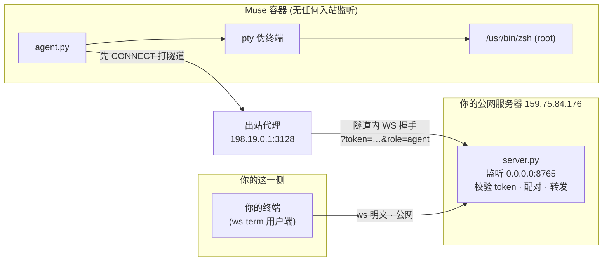
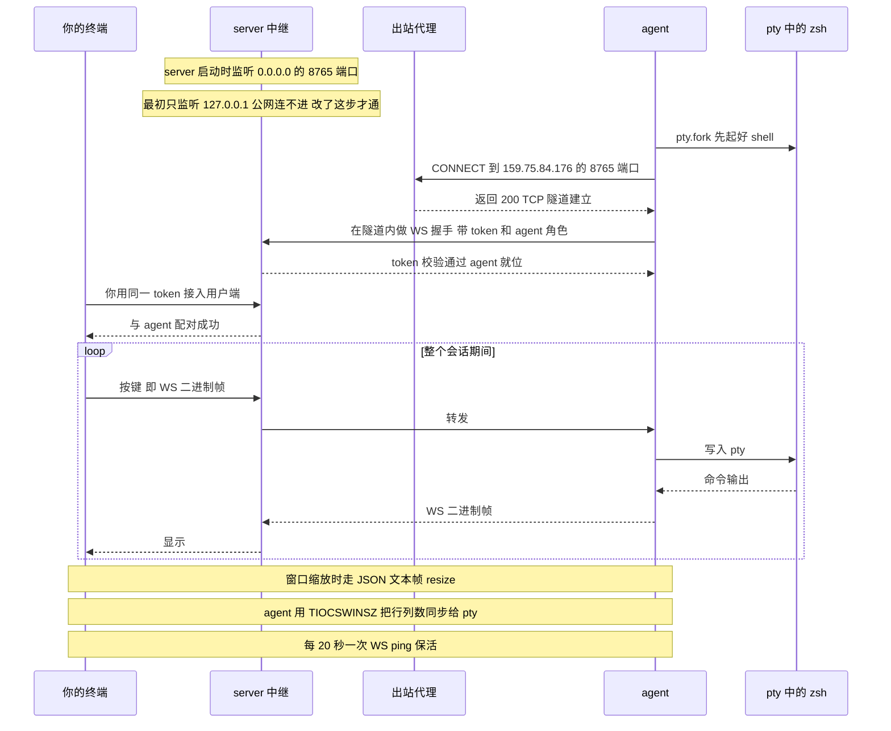

+++
title = "通过 ws-term 模拟 SSH 登录 Muse"
date =  2026-10-25
lastmod = 2026-10-25
draft = false

tags = ["muse", "调研", "Agent"]
summary = "通过 ws-term 工具模拟 SSH 登录到 muse 实例中，方便后续操作"
abstract = "通过 ws-term 工具模拟 SSH 登录到 muse 实例中，方便后续操作"

[header]
image = ""
caption = ""

+++

## 前沿

在上一篇博客中，我是通过 muse 的web页面或者 app 界面来操作 muse，虽然可以明确让 muse 执行 shell 命令，但终究是隔了 muse，不方便，交互速度也慢。

后来看到这篇文章的中文翻译版本，发现作者通过 ws-term 模拟了 ssh 登录 muse实例：

https://rohanadwankar.github.io/posts/sandbox2.html

感觉是个非常不错的做法，我准备效仿。

## ws-term 介绍

### ws-term 是什么

ws-term 是一个极简的开源小工具（github.com/rohanadwankar/ws-term），只有两个文件：

1. server.py：跑在一台双方都能到达的机器上，是个"哑中继"。它本身不提供 shell，只负责把两条 WebSocket 连接配对后双向转发字节流

2. agent.py：跑在目标机器上，它解决的核心问题是连接方向——目标机器（比如 muse 的这个容器）没有任何入站可达性：没有公网 IP、没有监听端口、外面连不进来。所以反过来，由 agent 主动向外拨号连到 server，把自己"挂"在那里等用户接入

鉴权只有一个共享 token，拼在连接 URL 上：`?token=<TOKEN>&role=agent`，server 校验 token 后才配对。数据面也很简单：二进制帧就是 pty 的原始字节流（用户敲的键、程序的输出），文本帧是 JSON 控制消息，目前只用了一种：{"type":"resize","rows":…,"cols":…}，用来同步终端窗口大小。server 设计上同时只接一个 agent，多连会被拒（busy）。

### 在 muse 中的使用

放到 muse 这套环境里，有三处和原版用法的差异：

1. 原版设计是 server 跑在用户本地、再用 ngrok 套一层 wss 暴露出来；我为了简单起见，直接把 server 放在有公网 IP 的服务器上监听 0.0.0.0:8765，然后设置防火墙放行，省了 ngrok，但代价是明文 ws（没有 TLS）。

2. muse 这边的出站流量必须走平台的 HTTP 代理（198.19.0.1:3128），不能直连任意地址，所以 muse 内用的 agent.py 是 vendored 版，唯一的改动就是加了 --proxy：先向代理发 CONNECT 159.75.84.176:8765 打一条 TCP 隧道，再在隧道里做 WebSocket 握手

3. agent 用 pty.fork() 在容器里起了一个真实的伪终端，exec 的是 /usr/bin/zsh——所以你进来之后是完整的交互式 shell（有 job control、能跑 vim/top、窗口缩放能同步）。但值得注意的是：落点是在 muse 容器内，不是VM/宿主机。

## 使用方式

### muse 内部的准备

和 muse 沟通，让它准备 ws-term 方便我们连接。

```bash
你可以使用 ws-term 从vm内部向外建立连接，然后我通过这个连接 ssh 到你，方便我直接执行一些命令
```

muse 的答复，还给了在外部需要的操作：

```bash
代码和依赖都准备好了。websockets 库已装好，agent.py 本身没问题。

你那边需要做两步：

1. 在你的机器上跑 server：

   TOKEN=$(openssl rand -hex 16)
   python3 server.py --port 8765 --token "$TOKEN"
   （server.py 在 https://github.com/rohanadwankar/ws-term 拿）

2. 用 ngrok 把它暴露出来：

    ngrok http 8765

   然后把 wss 地址（比如 wss://xxxx.ngrok-free.app）和 TOKEN 发我，我这边启动 agent 连过去。

   一个技术点：VM 出站全走 HTTP 代理，我这边会做一层 CONNECT 隧道转发，对你是透明的。
```

### muse 外部的操作

我找了一台有公网IP的服务器（实际就是部署我个人博客网站的机器，debian12系统），在这台机器上先 clone ws-term：

```bash
mkdir -p ~/work/soft
cd ~/work/soft

git clone  https://github.com/rohanadwankar/ws-term
cd ws-term
```

文件就3个：

```bash
➜  ws-term git:(main) ✗ ls -lh                                             
total 16K
-rw-r--r-- 1 sky sky 2.6K Oct 16 14:22 agent.py
-rw-r--r-- 1 sky sky  658 Oct 16 14:22 README.md
-rw-r--r-- 1 sky sky 3.4K Oct 16 14:22 server.py
```

先把依赖 websockets 安装好：

```bash
cd ~/work/soft/ws-term
python3 -m venv .venv
.venv/bin/pip install websockets
```

否则会报错：

```bash
Traceback (most recent call last): File "/home/sky/work/soft/ws-term/server.py", line 7, in <module> import websockets ModuleNotFoundError: No module named 'websockets'
```

生成一个 token 用于认证，安全起见每次用的时候临时生成，不落盘保存。简单起见这里没有使用 wss，监听地址主要要设置为 0.0.0.0 不然使用 127.0.0.1 muse 会无法连接：

```bash
TOKEN=$(openssl rand -hex 16)
echo "$TOKEN" 
.venv/bin/python server.py --host 0.0.0.0 --port 8765 --token "$TOKEN"
```

> 备注：如果有防火墙，则需要先在防火墙上设置，放行 8765 端口。

启动后输出为：

```bash
d164239d46cf917865054cde257a64bc
[server] listening ws://0.0.0.0:8765; expose it (ngrok http 8765) and point the agent at the wss:// url
```

然后告知 muse：

```bash
你可以通过 ws-term 连接上来了，我这边监听的IP是 159.75.84.176，端口是 8765，token 是 d164239d46cf917865054cde257a64bcxxxx
```

muse 顺利连接上来之后，muse 给出的提示：

```bash
连上了，Sky。agent 日志三行齐全：shell pid=3473 起好、CONNECT 隧道经 198.19.0.1:3128 打通、[agent] connected。你那边现在接入就能落进这个容器的 zsh。
```

我们的终端会有提示：

```bash
[server] agent connected — driving the remote shell
```

检查一下：

```bash
➜  ws-term pwd
/home/hatch/work/soft/ws-term
➜  ws-term id
uid=0(root) gid=0(root) groups=0(root)
```

这样就可以模拟 ssh 登录，执行各种命令，而不用每次都通过 muse 代劳了，快捷很多。

## 补充：ws-term 工作原理

上面场景下的工作原理，图是我让 muse 以 mermaid 格式画的：



连接建立的时序图：

